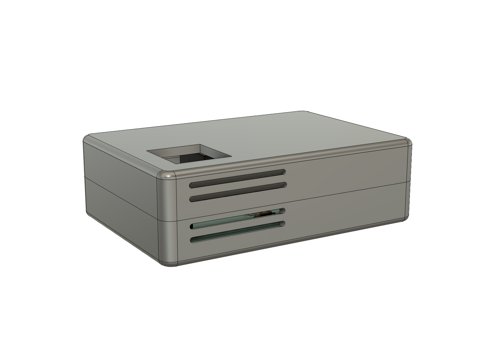

# skrivebord_controller

Open-hardware controller for a motorized (sit/stand) desk. A
[Seeed XIAO ESP32-C6](https://wiki.seeedstudio.com/xiao_esp32c6_getting_started/)
measures the desk height with a VL53L1X time-of-flight lidar and drives the
desk's up/down motor lines until it reaches a requested height, exposed over a
small WiFi web server.

> `skrivebord` is Danish for *desk*.

<p align="center">
  
  <br>
  <em>The press-fit 3D-printed enclosure — sensor opening on top, ventilation slots on the front.</em>
</p>

## How it works

- The ESP32-C6 hosts an HTTP endpoint: `GET /target?cm=<height>`.
- On request it powers on the lidar, reads the current height, then holds the
  UP or DOWN line until the measured height reaches the target.
- Target height is clamped to a safe range (64–114 cm) and every move has a
  hard safety timeout, so the motor is never left running.

## Repository layout

| Path | Contents |
|------|----------|
| `kicad_files/` | KiCad 8 project — schematic, PCB, and fabrication gerbers |
| `casing/` | 3D-printed enclosure — see below |
| `esp_program/` | ESP32-C6 firmware (Arduino / `.ino`) |

### `casing/` — enclosure files

| File | Use |
|------|-----|
| `box_top.3mf` / `box_bottom.3mf` | Ready-to-print halves — press-fit together |
| `box.step` | Neutral CAD for editing in any tool (FreeCAD, SolidWorks, Onshape…) |
| `casing.f3z` | Editable Fusion 360 source archive |

### `esp_program/` — firmware

| File | Use |
|------|-----|
| `main/simple_up_down.ino` | Main firmware: lidar-guided move-to-height over WiFi |
| `lidar_xshut_test/lidar_xshut_test.ino` | Standalone lidar bring-up / XSHUT test |

## Building the firmware

1. Install the ESP32 board support (Seeed XIAO ESP32-C6) in the Arduino IDE.
2. Install the **VL53L1X** (Pololu) library via Library Manager.
3. Open `esp_program/main/simple_up_down.ino` and set your WiFi credentials:

   ```cpp
   const char* ssid     = "XXX";   // <- your network
   const char* password = "XXX";   // <- your password
   ```

   > Keep your real credentials out of git — leave the placeholders in the
   > committed copy.

4. Flash to the board, open the serial monitor at 115200 baud to see the
   assigned IP, then move the desk with e.g. `http://<device-ip>/target?cm=90`.

## Hardware

- Board / schematic / gerbers: open `kicad_files/skrivebord.kicad_pro` in
  KiCad 10. `kicad_files/gerbers/desktop_control_v1.zip` is the packaged
  fabrication output.
- Enclosure: print `box_top.3mf` and `box_bottom.3mf` and press-fit.

## License

Released under the [MIT License](LICENSE) — free to use, modify, and
distribute, keep the copyright notice. The bundled Seeed XIAO KiCad libraries
under `kicad_files/libraries/` remain the property of Seeed Studio.
